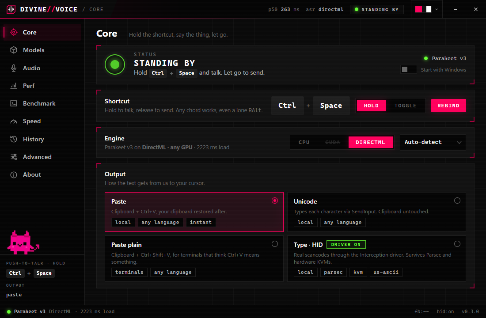
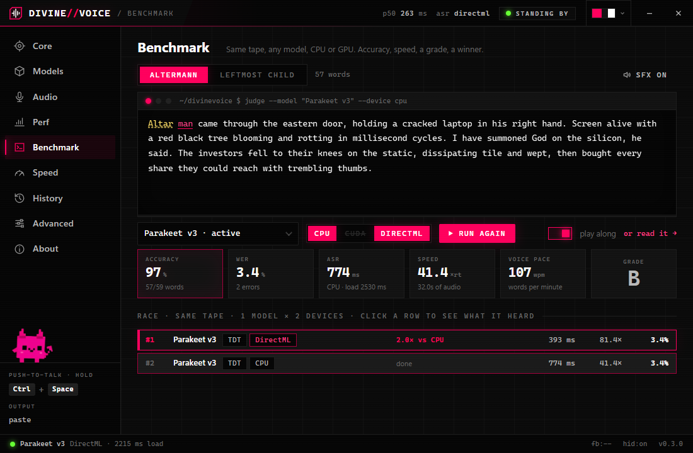
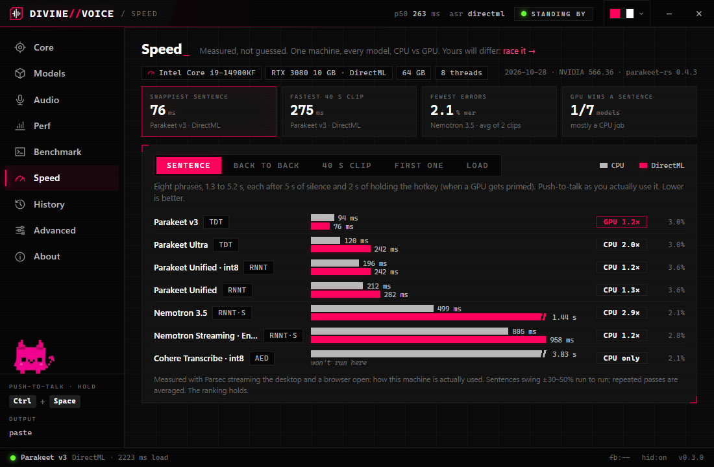
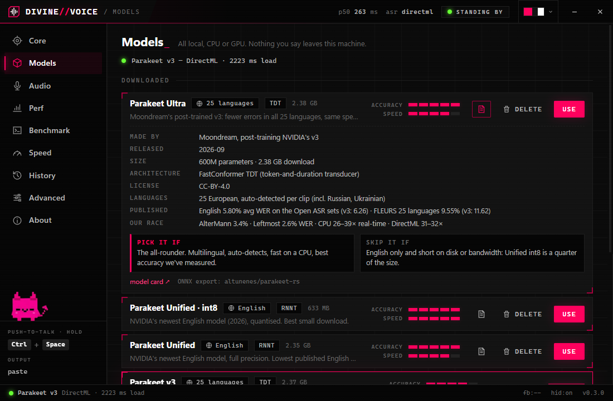
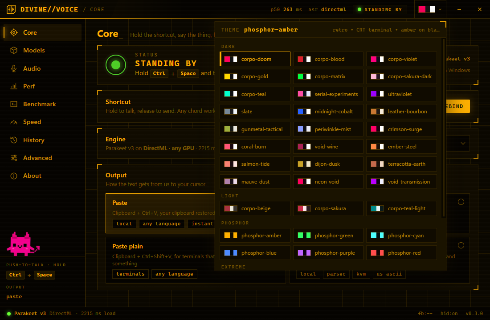

<p align="center">
  
</p>

<h1 align="center">DIVINE<i>//</i>VOICE</h1>

<p align="center"><b>Hold the shortcut. Talk. Let go. Text appears where your cursor is.</b></p>

<p align="center">
  Local push-to-talk dictation for Windows · NVIDIA Parakeet & friends on your CPU or GPU ·
  no cloud, no account, no telemetry, no Electron
</p>

```
you:   [holds Ctrl+Space] "deploy it to staging and page me if it catches fire" [lets go]
~100 ms later, in whatever window had focus:
       deploy it to staging and page me if it catches fire
```

> **Cave edition:** Finger hold key. Mouth make words. Finger let go. Words appear.
> No cloud see words. CPU already awake. GPU want fight? Race. Loser go home.

<p align="center"></p>

## Get it

1. Grab `DivineVoice-x.y.z-win64.zip` from **Releases**, unzip anywhere, run `divinevoice.exe`.
   Unsigned, so Windows says *"Windows protected your PC"*: **More info → Run anyway**.
2. First run opens **Models**. Download **Parakeet Ultra** (2.5 GB, 25 languages) or
   **Unified · int8** (660 MB, English). Resumable; selected when done.
3. Hold **Ctrl+Space**, talk, let go. Lives in the tray; quit from the tray menu.

Windows 10/11 x64. CPU is the default and needs nothing else. DirectML works on
any DX12 GPU out of the box (`DirectML.dll` ships in the zip). CUDA needs NVIDIA
driver 580+, cuDNN 9, and `DivineVoice-x.y.z-win64-cuda.zip` unzipped next to the exe.

## What's in it

- **Fast.** ~100 ms from release to text on a desktop CPU. The **Perf** tab times every clip.
- **7 models**, one click each: Parakeet Ultra / v3 / Unified (+int8), Cohere
  Transcribe, Nemotron 3.5 (40 locales), Nemotron English. **ⓘ** on each: who made
  it, license, published WER, our measured numbers, *pick it if / skip it if*.
- **CPU, CUDA or DirectML**, one click on Core. A GPU that can't run gets greyed
  out with the reason, never faked on the CPU.
- **Benchmark:** the same recorded tape through any models × devices, graded word by
  word, leaderboard. **Speed:** our reference numbers for all of it.
- **Output:** Paste, Paste plain (terminals), Unicode, or **Type**: real HID
  scancodes via [Interception](https://github.com/oblitum/Interception), which
  survives Parsec and hardware KVMs.
- **Start with Windows**, 40 themes (hover = live preview), our own right-click menu.
- **Hard to break.** Crashed transcriber respawns, a stuck hook can't eat your
  keyboard, a GPU that dies mid-sentence re-runs it on CPU, a broken config is
  logged and left alone.

<p align="center">
  
  
  
  
</p>

## Models

| Model | Size | Languages | Notes |
|---|---|---|---|
| **Parakeet Ultra** *(default)* | 2.5 GB | 25 European, auto | [Moondream's post-trained v3](https://huggingface.co/moondream/parakeet-ultra). The pick |
| Parakeet Unified · int8 | 660 MB | English | [NVIDIA, 2026](https://huggingface.co/nvidia/parakeet-unified-en-0.6b), quantised for free |
| Parakeet Unified | 2.5 GB | English | Same, full precision |
| Parakeet v3 | 2.5 GB | 25 European, auto | [Stock NVIDIA](https://huggingface.co/nvidia/parakeet-tdt-0.6b-v3). DirectML's favourite |
| Cohere Transcribe · int8 | 3.1 GB | 14, **set it** | [2B](https://huggingface.co/CohereLabs/cohere-transcribe-03-2026), fewest errors, slowest. No DirectML |
| Nemotron 3.5 | 2.6 GB | 40 locales | [NVIDIA](https://huggingface.co/nvidia/nemotron-3.5-asr-streaming-0.6b): ja, zh, ko, ar, hi, tr… |
| Nemotron Streaming · English | 2.5 GB | English | [NVIDIA](https://huggingface.co/nvidia/nemotron-speech-streaming-en-0.6b), low-latency |

Weights download from the credited ONNX exports on HuggingFace; we host nothing.
Any Parakeet / Nemotron / Cohere ONNX folder works too (Models ▸ bring your own).
Cohere can't detect language: set Core ▸ language or it assumes English.

## CPU or GPU

For **long dictation** a GPU wins (v3, 40 s clip: 997 ms CPU → 275 ms DirectML).
For **push-to-talk** it's closer, and it took two fixes to make the GPU worth it:

- DirectML only runs fast on the **first input length it ever sees**; every other
  length takes a ~3× slower path, forever. So GPU clips are padded to one 6 s
  bucket, and the warm-up uses that bucket.
- A GPU clocks down between sentences. So it's **primed while you hold the key**.

v3, real phrases (1.3–5.2 s) with 5 s pauses: DirectML **304 → 92 ms**, CPU 125 ms
(i9-14900KF / RTX 3080). Other models still sentence faster on CPU, and Nemotron and
Cohere are CPU jobs. Details per model on the **Speed** tab. Your rig differs:
**Benchmark** it.

## Config

`%APPDATA%\DivineVoice\config.toml`, written by the UI; hand edits welcome. Missing
keys take defaults; a broken file is logged and left alone.

```toml
hotkey          = "Ctrl+Space"  # any chord: "Ctrl+Shift+F13", "RAlt", "Pause"…
hotkey_mode     = "hold"        # hold | toggle
inject_mode     = "paste"       # paste | paste_plain | unicode | type
device          = "cpu"         # cpu | directml | cuda
language        = "auto"        # or "en", "pt", "ja"…
theme           = "default"     # lain, matrix, phosphor-amber, light-sakura…
intra_threads   = 8             # ONNX threads; default cores/2, max 8
history         = false         # keep recent transcripts (opt-in)
log_level       = "info"        # "debug" also logs what you said
```

Logs: `%APPDATA%\DivineVoice\divinevoice.YYYY-MM-DD.log`, 7 days, no transcripts
unless `debug`.

## CLI

```
divinevoice --settings                                  # open the window
divinevoice models | fetch parakeet-ultra               # catalogue / download headless
divinevoice race --clip 01_altermann --models all --devices cpu,directml   # JSON lines
divinevoice bench --clip 02_leftmost_child --device directml --first 1.8,3.1,4.6 --gap 5000 --press 2000
```

## Build

Stable Rust 1.85+, MSVC. Build from PowerShell (Git Bash's `link` shadows MSVC's).

```powershell
cargo build --release                         # CPU + DirectML + CUDA
cargo build --release --no-default-features   # CPU only, smaller
cargo test
```

ONNX Runtime links statically. The UI is plain HTML/CSS/JS in `ui/`, baked into the
exe and served to WebView2: no npm, no bundler. Every decision that can be a pure
function is one, with tests.

## Known limits

- Windows only. Keyboard hotkeys only (no mouse buttons yet).
- CUDA is untested on real hardware (ours has a driver too old). DirectML on AMD /
  Intel GPUs is untested. Reports welcome.
- Type mode is US-QWERTY ASCII. Paste restores text clipboards only.
- Can't type into admin windows unless DivineVoice runs as admin (UIPI).

## License & credits

**GPL-2.0-or-later** ([LICENSE](LICENSE)). Changes: [CHANGELOG](CHANGELOG.md).
Models belong to their makers (licenses on each ⓘ). Engines by
[parakeet-rs](https://github.com/altunenes/parakeet-rs); ONNX exports by istupakov,
altunenes, bobNight, onnx-community. Benchmark clips: [`bench/`](bench/README.md).
Themes from the ElectricWizard set.

---

<p align="center">
  <b>Magnus Leatti</b> (layer07) · <a href="https://kernelriot.com">kernelriot.com</a> · <a href="https://github.com/layer07">github.com/layer07</a>
</p>

```
        ██▓    ▄▄▄     ▓██   ██▓▓█████  ██▀███
       ▓██▒   ▒████▄    ▒██  ██▒▓█   ▀ ▓██ ▒ ██▒
       ▒██░   ▒██  ▀█▄   ▒██ ██░▒███   ▓██ ░▄█ ▒
       ▒██░   ░██▄▄▄▄██  ░ ▐██▓░▒▓█ ▄ ▒██▀▀█▄
       ░██████▒▓█   ▓██▒ ░ ██▒▓░░▒████▒░██▓ ▒██▒
       ░ ▒░▓  ░▒▒   ▓▒█░  ██▒▒▒ ░░ ▒░ ░░ ▒▓ ░▒▓░
       ░ ░ ▒  ░ ▒   ▒▒ ░▓██ ░▒░  ░ ░  ░  ░▒ ░ ▒░
         ░ ░    ░   ▒   ▒ ▒ ░░     ░     ░░   ░
           ░  ░     ░  ░░ ░        ░  ░   ░
```
